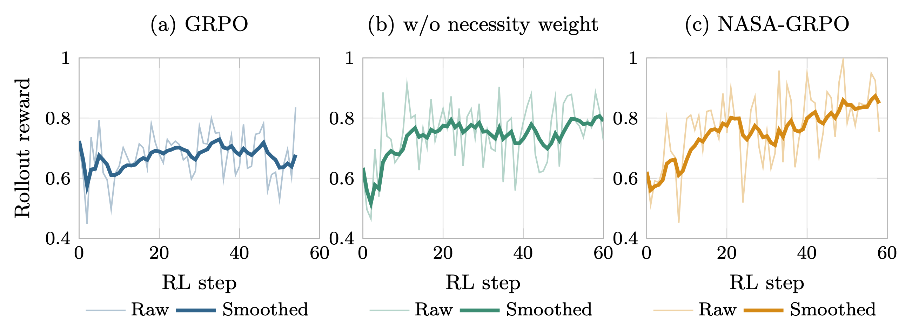
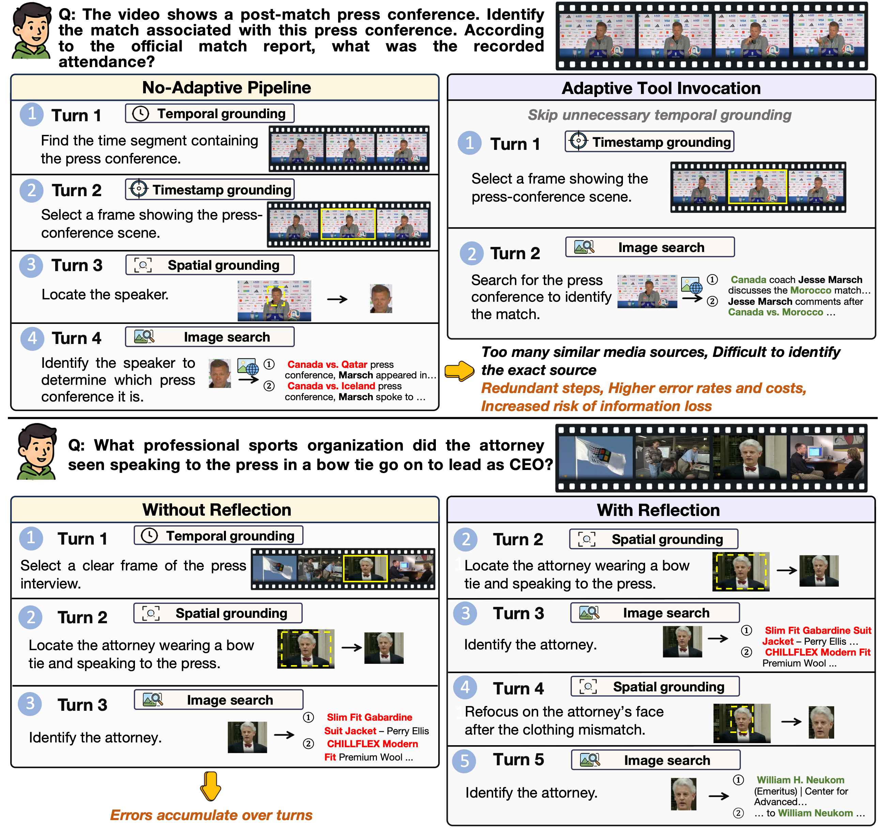
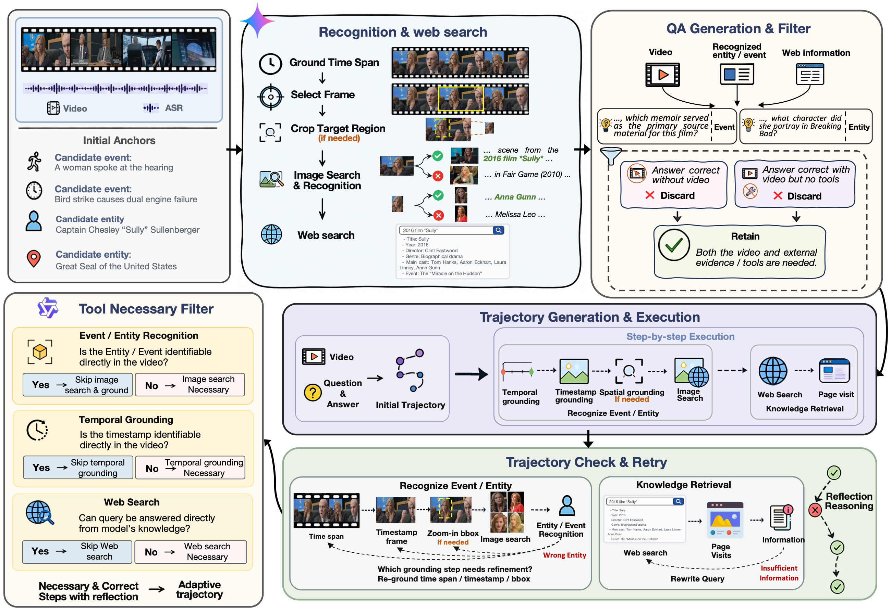
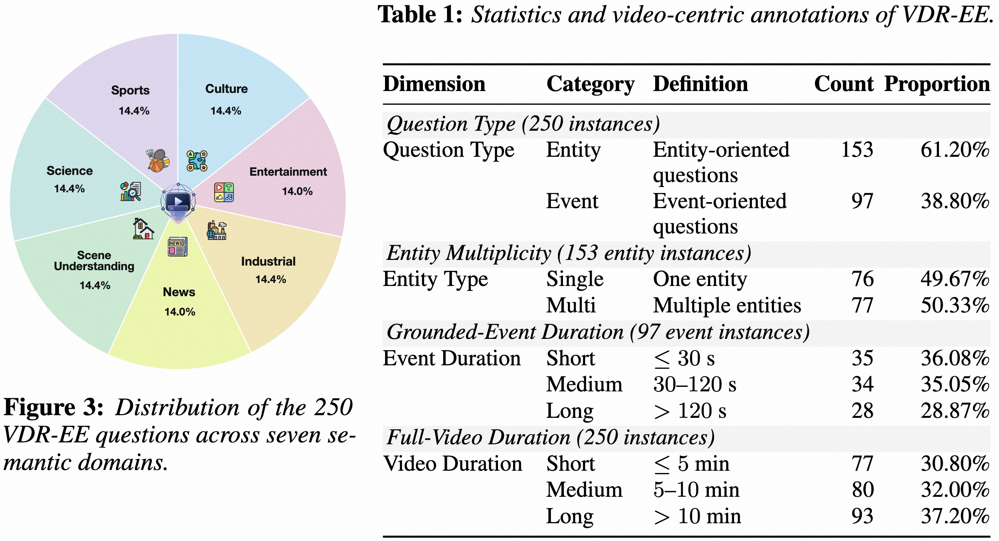
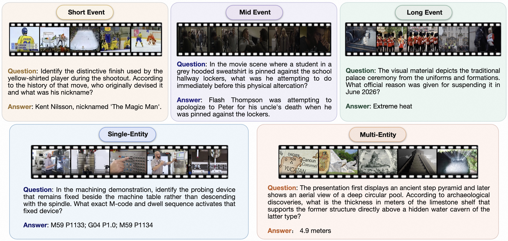
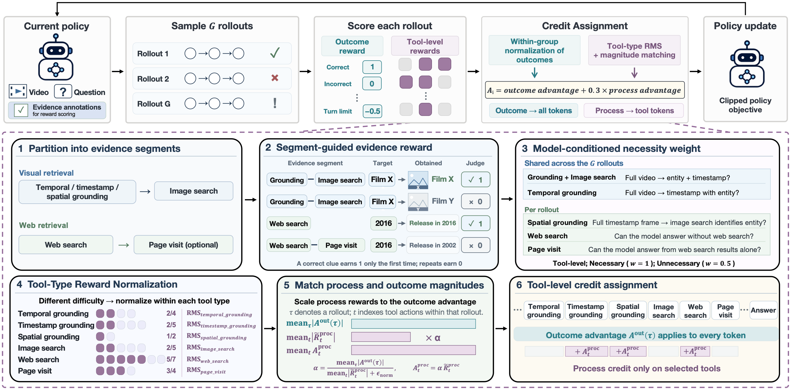
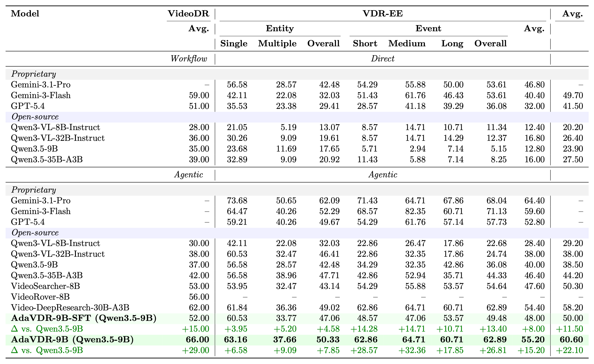
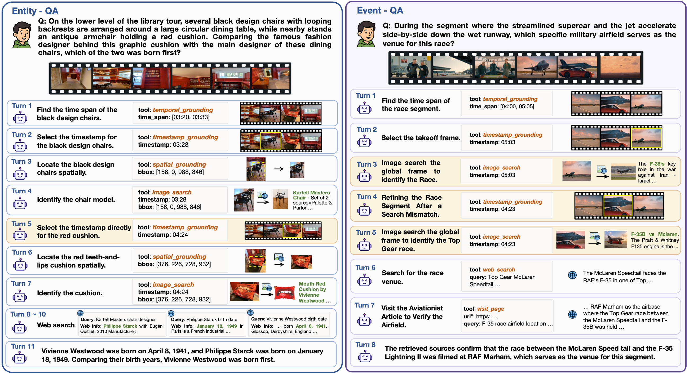

<div align="center">
  <h1>AdaVDR: Adaptive Tool Use and Reflection for Video Deep Research</h1>

  <p>
    <a href="https://github.com/xtong-zhang">Xintong Zhang</a><sup>1,2,*</sup>,
    <a href="https://scholar.google.com/citations?user=3hzR8qQAAAAJ&amp;hl=zh-CN">Xiaomeng Fan</a><sup>1,2,*</sup>,
    <a href="https://scholar.google.com/citations?user=2VhjOykAAAAJ&amp;hl=zh-CN">Shilin Yan</a><sup>1</sup>,
    <a href="https://accio-lab.github.io/AdaVDR/">Ekko He</a><sup>1</sup>,
    <a href="https://scholar.google.com/citations?user=PbA_HO0AAAAJ&amp;hl=zh-CN">Zicheng Liu</a><sup>1</sup>,
    <a href="https://github.com/Accio-Lab/AdaVDR">Zijian Zou</a><sup>1</sup>,
    <a href="https://accio-lab.github.io/AdaVDR/">Guannan Zhang</a><sup>1</sup><br>
    <a href="https://scholar.google.com/citations?user=MUF2MeAAAAAJ&amp;hl=en">Yuwei Wu</a><sup>2</sup>,
    <a href="https://zhigao2017.github.io/">Zhi Gao</a><sup>2,†</sup>,
    <a href="https://hellwayxue.github.io/">Hongwei Xue</a><sup>1,†</sup>
  </p>

  <p>
    <sup>1</sup>Accio Team, Alibaba Group<br>
    <sup>2</sup>Beijing Key Laboratory of Intelligent Information Technology, School of Computer Science &amp; Technology, Beijing Institute of Technology<br>
  </p>

  <p><sup>*</sup>Equal contribution &nbsp;&nbsp; <sup>†</sup>Corresponding author</p>

  <br>

  <a href="https://accio-lab.github.io/AdaVDR/">
    
  </a>
  <a href="paper/AdaVDR.pdf"></a>
  <a href="https://arxiv.org/pdf/2608.25559">
    
  </a>
  <a href="https://huggingface.co/Accio-Lab/VDR-EE-Benchmark">
    
  </a>
  <a href="https://github.com/Accio-Lab/AdaVDR">
    
  </a>
</div>

# 🔥 News

- [2026/10] We released the **[VDR-EE benchmark](https://huggingface.co/Accio-Lab/VDR-EE-Benchmark)** and evaluation code.
- [2026/10] We updated our paper, with the main update being the RL algorithm **NASA-GRPO**, a necessity-aware segment-guided credit assignment method, improving accuracy over the SFT model by **14.0 percentage points on VideoDR** and **7.2 percentage points on VDR-EE**.
- [2026/08] We released the AdaVDR paper on arXiv.

# TODO List

Release progress is tracked below:

- [x] Release the paper
- [x] Release the VDR-EE benchmark and evaluation code
- [ ] Release AdaVDR model weights
- [ ] Release training data and code

# Overview

Video deep research answers complex questions by jointly understanding video content and retrieving external knowledge from the open Web. Existing agents often follow fixed tool-use workflows, even though different questions, videos, and model capabilities require different strategies. Unnecessary grounding and retrieval increase latency and expose the reasoning process to additional errors, while unreliable intermediate evidence may propagate through subsequent steps.

We propose **AdaVDR**, an agent that adaptively selects tools and revises unreliable intermediate results. We develop these capabilities through two complementary components:

- **Data Construction:** We construct task-specific evidence-acquisition trajectories and apply model-conditioned tool necessity filtering to remove calls the base model can bypass. SFT on 2.9K verified trajectories initializes adaptive tool use and reflection.
- **RL Training — NASA-GRPO:** Our algorithm combines segment-guided evidence rewards, model-conditioned necessity weighting, and tool-type reward normalization to reward useful, necessary evidence acquisition. Beyond SFT, NASA-GRPO improves VideoDR accuracy from **52.00% to 66.00% (+14.00 percentage points)** and VDR-EE accuracy from **48.00% to 55.20% (+7.20 percentage points)**.

## Training Curves

The three panels compare **GRPO**, the variant **without necessity weighting**, and **NASA-GRPO**. NASA-GRPO maintains a higher smoothed rollout reward toward the end of the displayed training window. The curves complement the held-out accuracy results below.

<div align="center">
  
</div>

Pale and dark lines show raw and smoothed rewards. The curve without necessity weighting is approximately digitized from the training-dashboard screenshot.

# AdaVDR

## Adaptive Video Deep Research Agent

Rather than enforcing a fixed sequence of temporal grounding, timestamp grounding, spatial grounding, image search, Web search, and page visits, AdaVDR constructs task-specific and capability-specific reasoning trajectories. For example, it can skip temporal grounding when the relevant frame is directly identifiable, skip image search when an entity is already recognized, or skip Web search when the required knowledge is available internally.

When newly acquired evidence is irrelevant, inconsistent, or insufficient, AdaVDR identifies whether the failure originates from grounding or retrieval. It then selectively retries the corresponding step instead of restarting or reflecting after every interaction.

<div align="center">
  
</div>

## Data Construction

We develop a video deep research data construction pipeline with two main stages:

1. **QA generation:** discover retrieval-relevant entities and events from diverse videos, acquire detailed information through grounding and external retrieval, and construct questions that require both video evidence and external knowledge.
2. **Trajectory generation:** organize the evidence-acquisition process into executable, task-specific tool-use trajectories and refine invalid dependencies, parameters, and search results.

The pipeline further applies **model-conditioned tool necessity filtering** using **Qwen3.5-9B**, the base model that initializes AdaVDR-9B. Given the information available before a tool call, the target model is tested on whether it can obtain the expected result directly. Redundant tools or tool chains are removed, producing trajectories tailored to the target model's own capabilities.

<div align="center">
  
</div>

## VDR-EE Benchmark

The benchmark is available on [Hugging Face](https://huggingface.co/Accio-Lab/VDR-EE-Benchmark).

We introduce **VDR-EE**, a manually verified benchmark for entity-centric and event-centric video deep research. It contains **250 questions** across seven domains:

Culture, Entertainment, Industry, News, Scene understanding, Science, and Sports.

Every question requires both video evidence and external knowledge. The benchmark contains **153 entity-centric questions** and **97 event-centric questions**. Entity questions are grouped by the number of target entities, while event questions are grouped by target-event duration, enabling fine-grained evaluation across different video research patterns.

<div align="center">
  
</div>

VDR-EE covers single- and multi-entity questions as well as short-, medium-, and long-event questions. Representative examples are shown below.

<div align="center">
  
</div>

## Training

AdaVDR-9B is initialized from **Qwen3.5-9B** and trained in two stages:

- **SFT** on 2.9K verified trajectories initializes adaptive tool use and reflection.
- **RL Training — NASA-GRPO** further refines the SFT policy with outcome feedback and necessity-aware process credit.

NASA-GRPO consists of the following components:

- **Outcome reward:** Evaluates final-answer correctness and penalizes invalid rollouts or those reaching the turn limit.
- **Segment-guided evidence reward:** Credits correct target entities and external facts needed to answer the question. Previously obtained clues are not credited again.
- **Model-conditioned necessity weighting:** Tests whether the current policy can recover the same information without a tool and reduces credit for bypassable calls. The policy snapshot is refreshed at each RL iteration.
- **Tool-type reward normalization:** Normalizes process rewards within each tool type to balance tools with different positive-reward rates, then scales the process signal to match the outcome advantage.
- **Tool-level credit assignment:** Applies outcome feedback to all generated tokens and local process credit only to tokens of the credited tool action.

<div align="center">
  
</div>

# Results

We evaluate AdaVDR under the agentic setting on **VDR-EE** and **VideoDR**, using GPT-5.4 as the semantic answer judge. Improvements below are absolute percentage points over Qwen3.5-9B.

| Model | VDR-EE Entity | VDR-EE Event | VDR-EE Overall | VideoDR Overall |
| --- | ---: | ---: | ---: | ---: |
| Qwen3.5-9B | 42.48 | 36.08 | 40.00 | 37.00 |
| AdaVDR-9B-SFT | 47.06 | 49.48 | 48.00 | 52.00 |
| SFT improvement | +4.58 | +13.40 | +8.00 | +15.00 |
| **AdaVDR-9B** | **50.33** | **62.89** | **55.20** | **66.00** |
| **Final improvement** | **+7.85** | **+26.81** | **+15.20** | **+29.00** |

NASA-GRPO adds **14.00 points on VideoDR** and **7.20 points on VDR-EE** over the SFT model. The complete main-results figure includes baseline comparisons and question-type breakdowns.

<div align="center">
  
</div>

## Qualitative Cases

<div align="center">
  
</div>

The entity-centric example shows AdaVDR skipping redundant temporal grounding when the relevant timestamp can be selected directly. In the event-centric example, AdaVDR detects an unreliable image-search result, refines the temporal evidence, and performs a new retrieval path to identify and verify the event. These cases illustrate how adaptive tool invocation reduces unnecessary steps while reflection helps recover from unreliable intermediate evidence.

# Citation

If you find AdaVDR useful in your research, please consider citing our paper.

```bibtex
@article{zhang2026adavdr,
  title   = {AdaVDR: Adaptive Tool Use and Reflection for Video Deep Research},
  author  = {Zhang, Xintong and Fan, Xiaomeng and Yan, Shilin and He, Ekko and Liu, Zicheng and Zou, Zijian and Zhang, Guannan and Wu, Yuwei and Gao, Zhi and Xue, Hongwei},
  journal = {arXiv preprint arXiv:2608.25559},
  year    = {2026}
}
```
